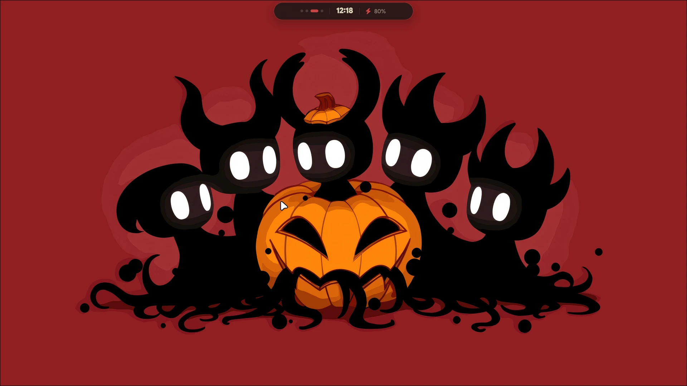
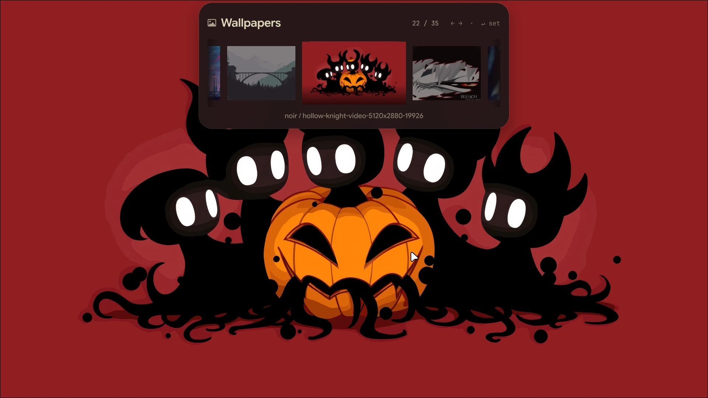
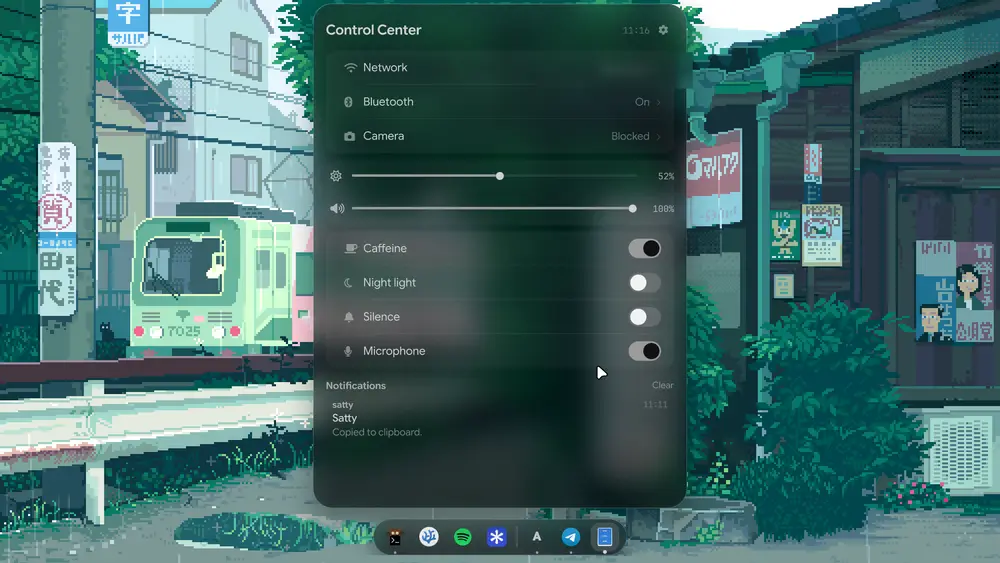
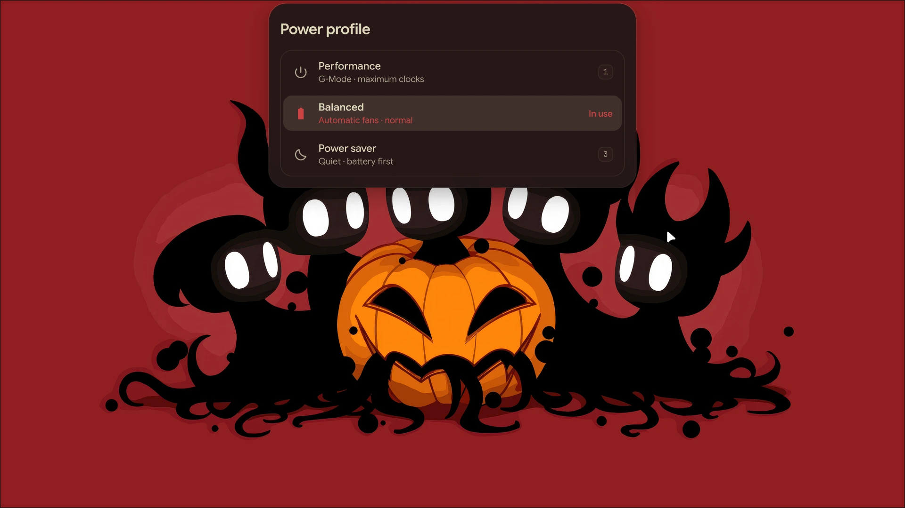
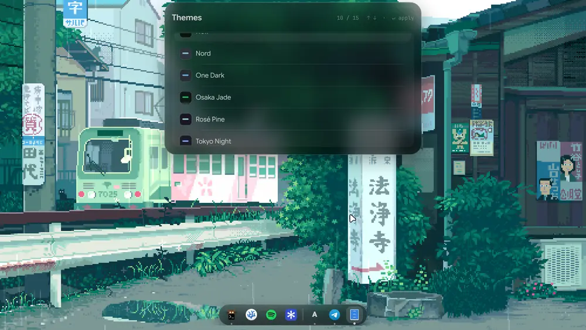
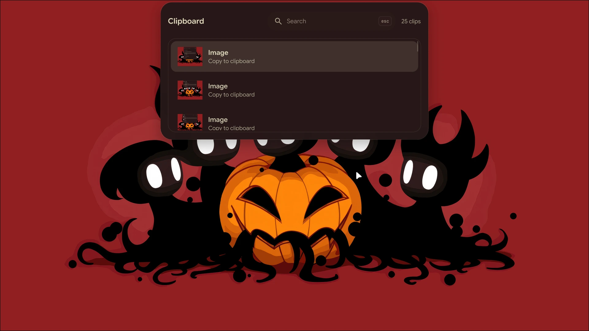
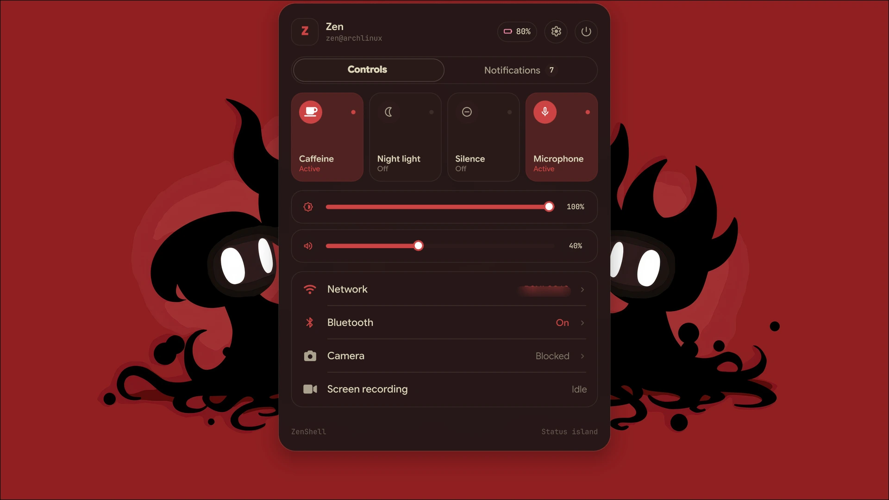

<div align="center">

# Zen Shell 🏝️

**The entire interface of [HyprZen](../README.md), in one Quickshell process.**

Dynamic Island, dock, an optional command bar, spotlight, control centre,
theme & wallpaper pickers, clipboard, and notifications.

<p>
  
  
  
</p>

<p>
  <a href="#previews">Previews</a> •
  <a href="#whats-in-the-box">What's in the box</a> •
  <a href="#installation">Installation</a> •
  <a href="#hyprland-integration">Hyprland integration</a>
</p>

</div>

---

Zen Shell replaces the four programs a Hyprland setup usually reaches for:
**rofi** (launcher), **waybar** (bar), **swaync** (notifications) and **eww**
(clock/widgets). HyprZen ships none of them, so nothing can conflict with this.

It talks to the system through small Python and Bash helpers in `scripts/` —
that seam is the easiest place to extend it.

## Previews

<p align="center">
  
  
</p>
<p align="center">
  
  
</p>
<p align="center">
  
  
</p>
<p align="center">
  
</p>

## What's in the box

- **Dynamic Island** — live now-playing with lyrics, notification stack, and
  volume/brightness OSD. Theme-aware: the accent comes from the active theme
  rather than a hardcoded colour.
- **Glassmorphic dock** — pinned apps plus running windows, with no system-tray
  clutter. Right-click an app for focus, new-window, pin/unpin, reorder and close
  actions; right-click bare dock space or press `SUPER + ALT + SHIFT + D` for
  dock settings.
- **Profile 02 command bar** — a floating or edge-mounted rail with workspaces,
  window title, now playing, clock, weather, system status and tray. Layout,
  position and individual widgets are live-configurable from its gear button.
- **Spotlight search** — centre-screen fuzzy app finder (`SUPER + SHIFT + M`).
- **Desktop widgets** — wallpaper-integrated clock, weather and system stats
  (`SUPER + D`).
- **Camera Effects** — a virtual webcam and virtual microphone with Center
  Stage, Portrait, Studio Light, backgrounds, filters, face effects,
  reactions, a privacy shutter, voice isolation and voice changers. The panel
  lives in the notification center (the **Camera** tile) and on `SUPER + ALT + C`.
  Ported from the [Omarchy plugin](https://github.com/alanfortlink/camera-effects).
- **Settings** — a full-screen settings app with a searchable page tree:
  wallpapers, themes, shell surfaces, profile and bar, dock, desktop widgets,
  alerts, power, camera and keyboard shortcuts. Opens on `SUPER + period`, from
  the gear in the command bar, or from the gear in the control centre.
- **Control centre** — Wi-Fi, Bluetooth, caffeine and microphone mute.
- **Clipboard manager** — `cliphist`-backed history.
- **Keybind cheatsheet** — a searchable index generated from your *actual*
  `keybinds.lua`, so it can't go stale.
- **Theme & wallpaper pickers** — read from the generated theme manifest, so all
  15 themes appear without touching a line of QML.

## Profiles

ZenShell has two shell profiles. Both share the same Quickshell process, theme,
media state, weather, launcher and notification stack, so switching is immediate.

| Profile | Surface |
| :--- | :--- |
| **01 · Island** | Dynamic island, dock and desktop widgets. |
| **02 · Bar** | Floating or edge-mounted command rail with toggleable widgets. The dock and desktop widgets hide while this profile is active. |

Switch with `SUPER + Alt + P`, from the control center's `PROFILE 01/02` chip,
or directly:

```bash
~/.config/quickshell/dynamic-island/island_ctl.sh profiles      # open the switcher
~/.config/quickshell/dynamic-island/island_ctl.sh bar           # go to Profile 02
~/.config/quickshell/dynamic-island/island_ctl.sh island        # go to Profile 01
~/.config/quickshell/dynamic-island/island_ctl.sh bar-settings  # open bar layout settings
~/.config/quickshell/dynamic-island/island_ctl.sh dock          # toggle dock auto-hide
~/.config/quickshell/dynamic-island/island_ctl.sh dock-settings # open dock menu
```

The bar's gear button opens the **Profile & Bar** page of the settings app,
where **Floating / Edge**, **Top / Bottom** and the widget toggles live.
Changes apply live and are stored in `shell_settings.json`; the dock and
desktop-widget processes watch that file, so no process restarts are needed.

## Settings

ZenShell has one settings app, and it is a real surface rather than a set of
scattered toggles: a modal window on its own overlay layer, with a searchable
tree of pages on the left and the active page on the right.

| | |
| :--- | :--- |
| **Open it** | `SUPER + period`, the gear in the command bar, the gear in the control centre, or `island_ctl.sh settings` |
| **Open a page** | `island_ctl.sh settings <page>` — e.g. `settings power`, `settings colors` |
| **Pages** | Wallpaper · Theme & Colors · Typography & Motion · Profile & Bar · Dock · Desktop Widgets · Alerts & Media · Power & Performance · Camera · Keyboard |
| **Search** | filters the page tree *and* the wallpaper and theme grids, so "nord" narrows the themes to the one you mean |
| **Keys** | `Esc` clears the search, then closes the window |

Everything is stored in `~/.config/quickshell/shell_settings.json` and applied
live: the window writes through one `setValue()` door, so the store, the shell
and the persisted file never disagree. The control centre's caffeine, night
light and Do Not Disturb switches go through that same door — they are two
views of one setting, not two switches that fight each other.

## Camera Effects

ZenShell ships a port of the [Camera Effects](https://github.com/alanfortlink/camera-effects)
plugin: a virtual webcam and a virtual microphone that every app can pick
instead of the real hardware.

| | |
| :--- | :--- |
| **Open the panel** | the **Camera** tile in the notification center (`SUPER + N`) or `SUPER + ALT + C` |
| **Tabs** | Video · Look · Fun · Mic · Privacy |
| **Camera** | Presets (Clean · Portrait · Studio · Call · Gaming), Center Stage, zoom/pan, fit, rotate, mirror, Portrait, Studio Light, backgrounds, filters, face effects, ambience, reactions, snapshots |
| **Output size** | 720p / 1080p / 1440p / 4K at 15–60 fps, with a real-time upscale when the output is bigger than the camera's capture size |
| **Hand gestures** | react to a held ✌ / 👍 / 👎 / 🤘 / 🫶 with a reaction, with a live badge over the preview |
| **Performance** | the pipeline's own frame time, fps and CPU tier in the footer |
| **Per camera** | one set of effects for every webcam, or a set per webcam — the switch appears as soon as a second camera is plugged in |
| **Microphone** | voice isolation, noise gate, auto level, de-esser, rumble and hum filters, tone, voice changers, spaces, presets, before/after meters |
| **Privacy** | block the camera with a card, an image or a video; hide the raw camera and the raw microphones from apps |

The daemon is upstream's (`camera-effects-server`, C++ with OpenCV and four
small ONNX models); the panel is ZenShell's, rebuilt with the island's tokens
so it reads as part of the shell rather than a guest in it.

The daemon half is installed once:

```bash
# build + install the daemon (no root)
~/.config/quickshell/dynamic-island/scripts/camera_effects_install.sh
# ... and create the virtual camera (asks for your password)
~/.config/quickshell/dynamic-island/scripts/camera_effects_install.sh --root
```

The panel can do both itself: if the daemon is missing it offers **Install**,
and if the virtual camera has not been created yet it offers **Set up**.
`./install.sh --with-camera` does the whole thing on a fresh install.

Everything the panel shows comes from the daemon, so the CLI works too:

```bash
camera-effects-server status
camera-effects-server set portrait=true zoom=1.5
camera-effects-server react hearts
camera-effects-server snap
```

The output size is not a socket command — the daemon reads it from its config
at startup — so it is changed through the shell (which stops the daemon,
writes the config and starts it again):

```bash
~/.config/quickshell/dynamic-island/island_ctl.sh camera-output 2560 1440 30
```

> The upstream plugin expects the Omarchy shell. This port keeps the daemon
> and the protocol and replaces the Omarchy plumbing: the panel is a ZenShell
> component, the install path is `scripts/camera_effects_install.sh`, and the
> notification command is `notify-send`. Upstream is MIT licensed; the daemon,
> the models and the assets are theirs.

## Installation

**Recommended** — the top-level installer handles this and everything ZenShell
depends on:

```bash
git clone https://github.com/zenXD45/zenshell.git
cd zenshell
./install.sh
```

Standalone:

```bash
git clone https://github.com/zenXD45/zenshell.git
./zenshell/install.sh
./zenshell/install.sh --with-camera   # optional: virtual camera daemon
```

The installer backs up anything already at
`~/.config/quickshell/dynamic-island`, bootstraps `paru-bin` when no AUR helper
is present, and marks the helper scripts executable. Re-running it refreshes the
code but keeps `shell_settings.json` and the dock's pinned apps. A password
prompt is normal — packages are installed with `pacman`.

ZenShell reads themes from `~/scripts/theme-switch.sh` and wallpapers from
`~/wallpapers`, both provided by [HyprZen](../hyprzen/README.md), so install
that half first.

## Hyprland integration

The suite autostarts from HyprZen's `exec.lua` via `start_all.sh` — there's
nothing to add. If you're wiring ZenShell into a *different* Hyprland config:

```ini
exec-once = ~/.config/quickshell/dynamic-island/start_all.sh
```

or, in a Lua config:

```lua
hl.exec_cmd("~/.config/quickshell/dynamic-island/start_all.sh")
```

### Keybinds

With HyprZen these are already bound. If you need them elsewhere, everything
routes through `island_ctl.sh` except spotlight and widgets, which are their own
Quickshell processes:

```lua
local ISLAND = "~/.config/quickshell/dynamic-island/island_ctl.sh"

hl.bind("SUPER", "SPACE",   hl.dsp.exec_cmd(ISLAND .. " launcher"))
hl.bind("SUPER", "comma",   hl.dsp.exec_cmd(ISLAND .. " cheatsheet"))
hl.bind("SUPER", "period",  hl.dsp.exec_cmd(ISLAND .. " settings"))
hl.bind("SUPER", "V",       hl.dsp.exec_cmd(ISLAND .. " clipboard"))
hl.bind("SUPER", "T",       hl.dsp.exec_cmd(ISLAND .. " themes"))
hl.bind("SUPER", "W",       hl.dsp.exec_cmd(ISLAND .. " wallpapers"))
hl.bind("SUPER", "N",       hl.dsp.exec_cmd(ISLAND .. " control"))
hl.bind("SUPER", "escape",  hl.dsp.exec_cmd(ISLAND .. " power"))
hl.bind("SUPER + SHIFT", "P", hl.dsp.exec_cmd(ISLAND .. " powerprofile"))
hl.bind("SUPER + ALT", "D", hl.dsp.exec_cmd(ISLAND .. " dock"))
hl.bind("SUPER + ALT + SHIFT", "D", hl.dsp.exec_cmd(ISLAND .. " dock-settings"))
hl.bind("SUPER + ALT", "C", hl.dsp.exec_cmd(ISLAND .. " camera"))
hl.bind("SUPER + SHIFT", "M",
    hl.dsp.exec_cmd("~/.config/quickshell/dynamic-island/modules/spotlight/toggle.sh"))
hl.bind("SUPER", "D", hl.dsp.exec_cmd(
    "quickshell ipc -p ~/.config/quickshell/dynamic-island/modules/desktop-widgets call widgets toggle"))
```

## Structure

```text
zenshell/
├── shell.qml            # entry point and root island window
├── island_ctl.sh        # open/close island modules over Quickshell IPC
├── start_all.sh         # starts island, dock, widgets and the monitors
├── components/          # UI: launcher, OSD, control panel, settings, ...
├── modules/
│   ├── dock/            # separate Quickshell process
│   ├── spotlight/       # separate Quickshell process
│   └── desktop-widgets/ # separate Quickshell process
└── scripts/             # the system-data seam: Python & Bash helpers
    ├── get_apps.py          # launcher entries
    ├── get_keybinds.py      # cheatsheet source (parses keybinds.lua)
    ├── get_themes.py        # reads HyprZen's generated themes.json
    ├── get_wallpapers.py    # scans ~/wallpapers and ~/Pictures/Wallpapers
    ├── get_clipboard.py     # cliphist wrapper
    ├── get_lyrics.py        # now-playing lyrics
    ├── get_search.py        # app search, icons and calculator
    ├── set_setting.py       # atomic writes to shell_settings.json
    ├── network_ctl.py       # NetworkManager
    ├── bluetooth_ctl.py     # bluez
    └── themes.json          # generated manifest (do not hand-edit)
```

## Notes

- **`themes.json` is generated.** It's produced by
  `hyprzen/scripts/gen-themes.py` and copied by the installer. Edit the TOML
  sources under `hyprzen/.config/hypr/themes/source/`, never this file.
- **Settings are seeded, not owned.** The installer copies `shell_settings.json`
  into `~/.config/quickshell/` only if it's absent, so your runtime changes
  survive reinstalls. Every change made in the settings app is written back
  atomically by `scripts/set_setting.py` and watched live by the shell, dock
  and widgets.
- **Paths are relative.** Everything resolves through `$HOME` /
  `Qt.homePath()`, so the repo runs wherever it's cloned.
